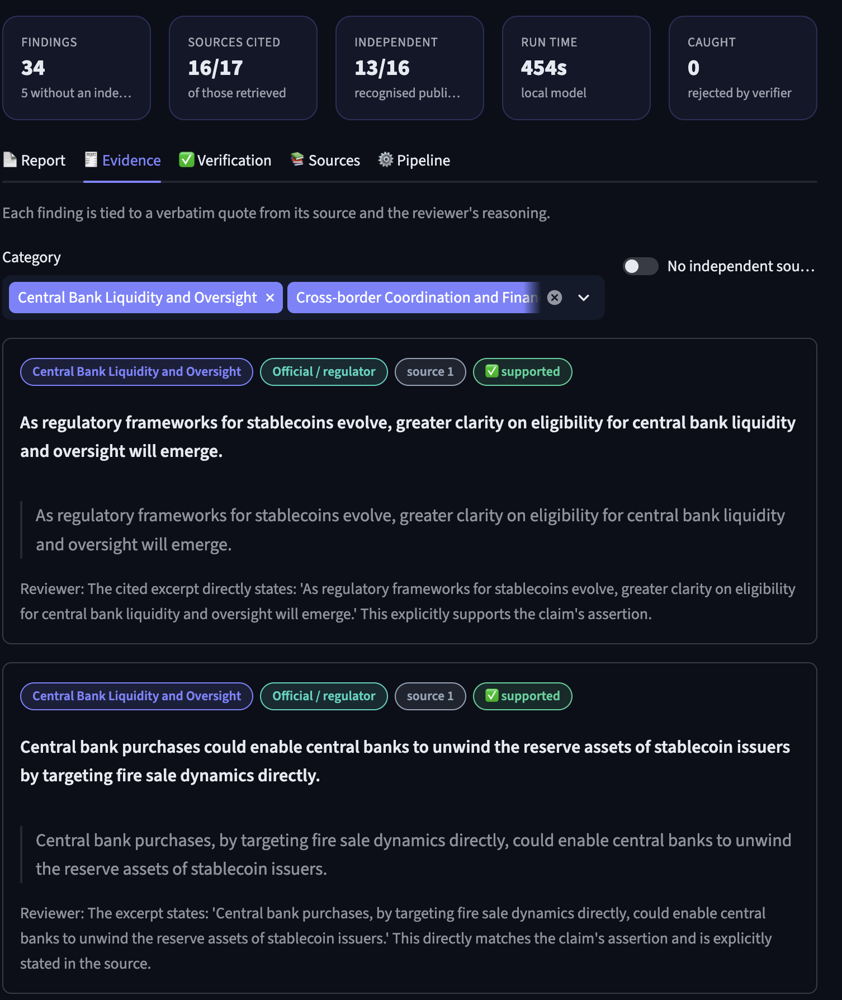
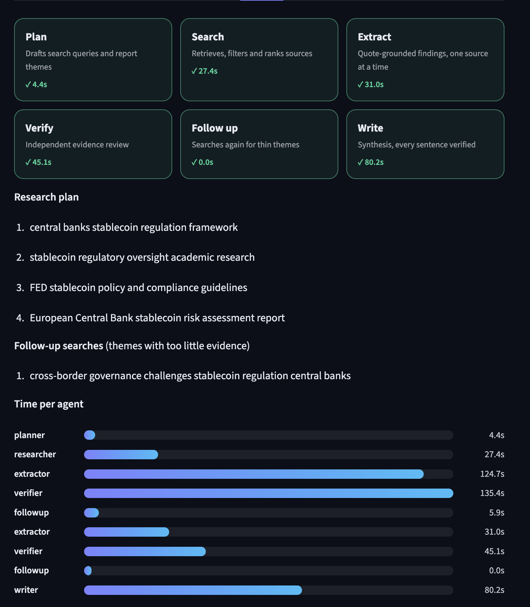
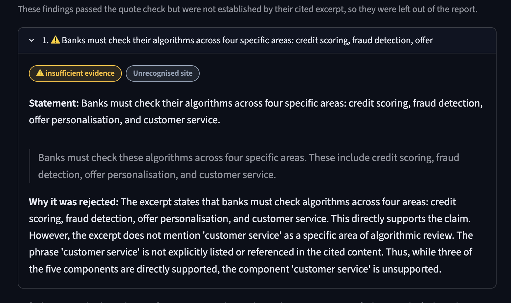
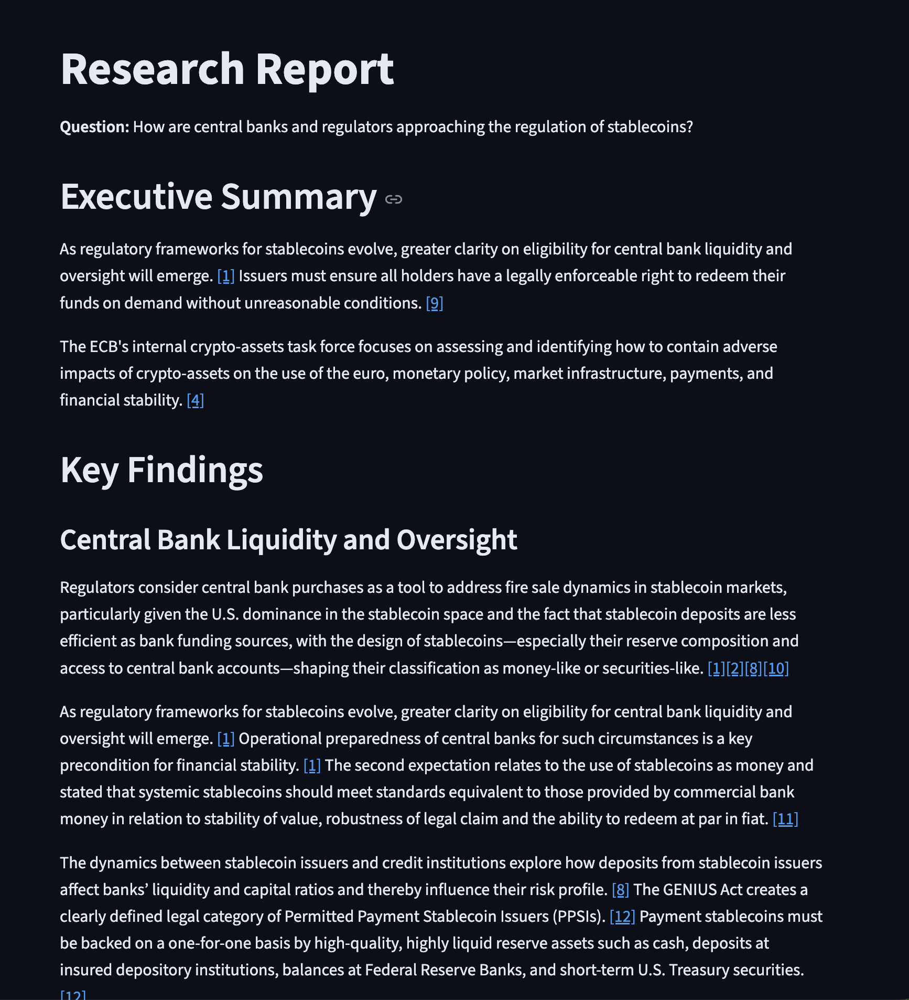
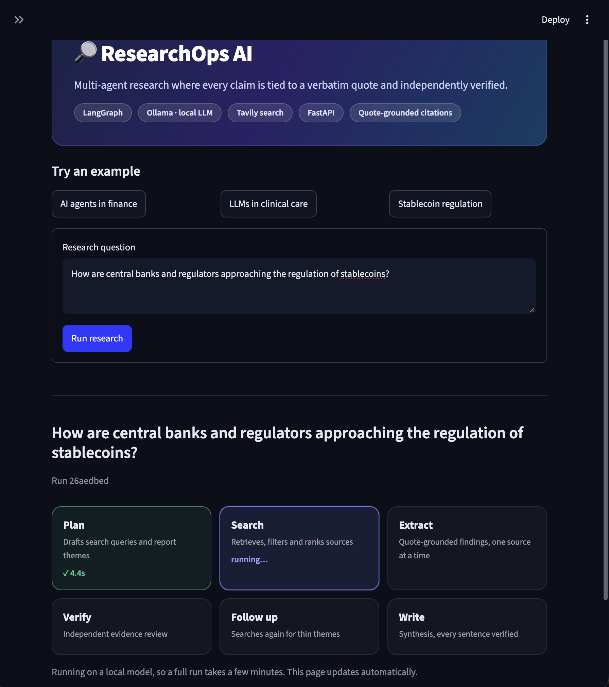

# ResearchOps AI

[](https://github.com/hamzehjarrarr/ResearchOps/actions/workflows/ci.yml)

A research agent that answers questions from web sources and **only reports what it
can back with a verbatim quote**. It runs fully locally on a laptop with a 4B model
(`qwen3:4b-instruct` through Ollama), searches with Tavily, and is built with
LangGraph, FastAPI and Streamlit.



**[Read a full example report →](docs/example-report.md)**: *How are central banks
and regulators approaching the regulation of stablecoins?* 34 verified findings from
16 cited sources, 12 of them regulators and central banks.

## Why

Small local models are cheap and private, but they drift. Asked "how are AI agents
changing credit risk analysis?", a 4B model will turn a sentence about a
machine-learning scoring engine into a claim about AI agents, because that is what
the question wants to hear.

ResearchOps treats every model output as untrusted. Each finding must come with an
exact quote from its source; code checks the quote, the numbers and the topic, and a
second model pass reviews the claim. Anything that fails is dropped, shown in the
dashboard with the reason, and the report says plainly where the evidence is thin.

## How it works

An agentic LangGraph workflow: six specialised steps and a follow-up loop that
searches again when the evidence for a theme is too thin.

```
planner ─► researcher ─► extractor ─► verifier ─► follow-up ──► writer ─► report
                            ▲                         │
                            └──── new sources ────────┘
                              (themes with too little evidence)
```

| Step | What it does |
|------|--------------|
| **Planner** | Names the question's subject, writes search queries (at least one aimed at regulators or research) and proposes report themes. |
| **Researcher** | Runs Tavily searches, two of them restricted to regulators, central banks and research publishers. Drops off-topic results and duplicate documents, labels each source by type, and keeps the page passages that best match the question. |
| **Extractor** | Asks the model for findings from each source, each with a quote, then checks them in code (below). |
| **Verifier** | A separate model pass reviews every finding against its source, claim by claim. A claim with any unsupported part is rejected. |
| **Follow-up** | If a planned theme has fewer than two verified findings, writes new searches for it and sends the new sources back through extraction and verification. |
| **Writer** | Writes a direct answer and short paragraphs per theme from the verified findings only. Every sentence must cite findings, pass the same code checks, and pass the verifier against the findings it cites. |



### The checks

| Check | Type | Catches |
|-------|------|---------|
| Quote is in the source | Code | Invented or paraphrased quotes |
| Every number appears in the source | Code | Altered figures ("$120 billion" for "$97 billion") |
| No question topic the source never mentions | Code | Drift: "AI agents…" from a page about machine learning |
| Not a bibliography entry | Code | Reference-list titles presented as findings |
| Stands on its own | Code | "Our results…", "This approach…" |
| Each part of the claim is supported | Model | Overstated scope, guidance stated as a requirement, forecasts stated as facts |
| Final report matches verified statements | Code | Any sentence that changed after verification |

The report ends with **Gaps in the evidence**, worked out from the run's own numbers
rather than written by the model: themes with no or one verified finding, how many
findings are actually about the question's subject, whether any regulator or academic
source was cited, and how many findings were rejected.

*A finding rejected by the verifier, from the EU AI Act run in the table below. The extractor's statement matched its quote, but the reviewer found a part of the claim it judged unsupported, so the finding was left out of the report.*


## Example runs

Real runs, unedited, each about 6–8 minutes on a laptop.

| Question | Verified findings | Sources cited | Independent* | Rejected by verifier | Follow-up round |
|----------|------------------:|--------------:|-------------:|---------------------:|:---------------:|
| Stablecoin regulation by central banks | 34 | 16 of 17 | 13 of 16 | 0 | Yes |
| AI agents in credit risk analysis | 25 | 12 of 12 | 9 of 12 | 2 | No |
| EU AI Act and banks' use of AI | 23 | 10 of 16 | 4 of 10 | 1 | Yes |

\* Cited sources from regulators, central banks, research publishers, think tanks or
established news outlets. Vendor and unrecognised sites are flagged.

The first version of this project answered the credit-risk question with 6 findings
from 5 of 12 sources. Reading page text instead of search snippets, deduplicating
sources, the follow-up loop and the writer raised that to 25 findings from all 12
sources. The same run showed that only 4 of the report's sentences were about AI
agents specifically; the rest of the evidence covers AI in general, and the report
now says so in its gaps section instead of overstating it.

| Report | Live progress |
|--------|---------------|
|  |  |

## Run it locally

You need Python 3.11+, [Ollama](https://ollama.com) and a
[Tavily](https://tavily.com) API key.

```bash
git clone https://github.com/hamzehjarrarr/ResearchOps.git
cd ResearchOps

ollama pull qwen3:4b-instruct

python3 -m venv .venv
source .venv/bin/activate
pip install -r requirements.txt
cp .env.example .env          # then add your Tavily key to .env
```

Terminal 1:

```bash
uvicorn researchops.api:app --reload
```

Terminal 2:

```bash
streamlit run dashboard.py
```

Open http://localhost:8501. The API docs are at http://localhost:8000/docs.

With Docker (Ollama still runs on the host):

```bash
docker compose up --build
```

## Configuration

All settings are optional; see `.env.example`.

| Variable | Default | Meaning |
|----------|---------|---------|
| `OLLAMA_MODEL` | `qwen3:4b-instruct` | Any Ollama chat model that supports JSON output. |
| `SEARCH_DEPTH` | `advanced` | Tavily depth; `basic` uses fewer credits but returns less text. |
| `USE_PAGE_TEXT` | `true` | Read page text instead of search snippets. |
| `MAX_SOURCES` | `12` | Sources read in the first round. |
| `MIN_FINDINGS_PER_THEME` | `2` | Below this, a theme triggers a follow-up search. |
| `MAX_FOLLOWUP_ROUNDS` | `1` | `0` turns the follow-up loop off. |
| `ENABLE_WRITER` | `true` | `false` lists the verified findings without synthesis. |

## API

| Method | Path | |
|--------|------|-|
| `POST` | `/research` | Start a run: `{"question": "..."}`. Returns a run id. |
| `GET` | `/runs/{id}` | Status, live progress and the result. |
| `GET` | `/runs` | Recent runs. |
| `GET` | `/health` | Whether Ollama, the model and the Tavily key are available. |

## Project layout

```
researchops/
  graph.py        LangGraph workflow and the follow-up loop
  planner.py      subject, search queries and themes
  researcher.py   search, filtering, deduplication, follow-up searches
  extractor.py    quote-grounded findings
  verifier.py     independent review of findings
  writer.py       verified synthesis
  report.py       report assembly, evidence gaps, final check
  audit.py        claim splitting and model-based claim review
  grounding.py    code checks and source classification
  themes.py       theme handling and regrouping
  llm.py          Ollama calls with JSON-schema output
  api.py, store.py, config.py, state.py
dashboard.py      Streamlit front end
tests/            81 tests; the model and search are mocked, so they run offline
docs/             example report and screenshots
```

## Stack

Python · LangGraph · Ollama (`qwen3:4b-instruct`) · Pydantic · Tavily · FastAPI ·
SQLite · Streamlit · Docker · pytest · ruff · GitHub Actions

## Tests

```bash
pytest -q
```

CI runs ruff and the test suite on every push.

## Limitations

- **The verifier is a 4B model and makes mistakes in both directions.** It
  occasionally rejects a correct finding (one run rejected a quote for leaving out a
  phrase that was in it). The code checks make it fail closed: a weak run produces a
  shorter report, not an invented one.
- **Sources are not checked for date.** A finding can be accurate to its source but
  out of date. One run quoted an older ECB paper saying the EU AI Act had not yet been
  published, which was true when the paper was written.
- **Verification uses the retrieved passages**, not whole documents.
- **Source types come from domain lists**, so a reputable site that is not on them is
  labelled "unrecognised" and does not count as independent.
- **Each run takes several minutes on a laptop** and uses Tavily credits (advanced
  searches cost two credits each).
- This is a research assistant, not financial or legal advice.

## License

MIT